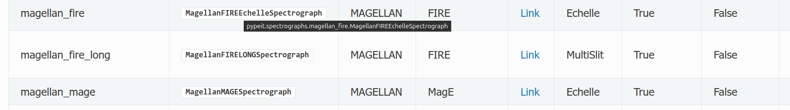

10.21

>calib的话可以考虑让science是0 standard是1
>
>combi_id和bkg id你之前的方式没问题
>
>.pypeit 文件里面 
>
>可以把arc frame扔掉，然后frametype把science 换成arc,science,tilt
>
>我建议把standard 对应的frametype 换成arc,standard,tilt试一下

添加了code_only_ref文件夹，存放别人的参考参数

添加了FIRE_Echelle_COCONUTS2A，放echelle的原始数据，上述两个文件夹不上传到网上。

原来的文件夹更名为magellan_fire_long_A_prime，新的数据放在magellan_fire_long_A_echelle

新的.pypeit文件：

```bash
# Auto-generated PypeIt input file using PypeIt version: 2.0.1
# UTC 2026-10-21T14:27:52.275+00:00

# User-defined execution parameters
[rdx]
    spectrograph = magellan_fire

# Setup
setup read
Setup A:
  decker: default
  dichroic: default
  dispname: Echelle
setup end

# Data block 
data read
 path /mnt/disk1/myresource/fire/FIRE_Echelle_COCONUTS2A
        filename |       frametype |          ra |         dec |      target | dispname |  decker | binning |                mjd | airmass | exptime | dichroic | calib | comb_id | bkg_id
  fire_0058.fits |arc,science,tilt |  117.073615 |  -76.773638 | COCONUTS-2A |  Echelle | default |     1,1 |   2461191.44306713 |   1.592 |     1.0 |  default |     0 |       0 |      1
  fire_0059.fits |arc,science,tilt | 117.0753893 | -76.7732809 | COCONUTS-2A |  Echelle | default |     1,1 |  2461191.444305556 |   1.595 |     1.0 |  default |     0 |       1 |      0
  fire_0060.fits |arc,science,tilt | 117.0754755 | -76.7732255 | COCONUTS-2A |  Echelle | default |     1,1 |  2461191.445185186 |   1.596 |     1.0 |  default |     0 |       1 |      0
  fire_0061.fits |arc,science,tilt | 117.0735337 | -76.7735822 | COCONUTS-2A |  Echelle | default |     1,1 |  2461191.446296297 |   1.599 |     1.0 |  default |     0 |       0 |      1
  fire_0062.fits |arc,science,tilt | 117.0736175 | -76.7735824 | COCONUTS-2A |  Echelle | default |     1,1 | 2461191.4470486115 |     1.6 |     1.0 |  default |     1 |       2 |      3
  fire_0063.fits |arc,science,tilt | 117.0754791 | -76.7731422 | COCONUTS-2A |  Echelle | default |     1,1 | 2461191.4481712966 |   1.603 |     1.0 |  default |     1 |       3 |      2
  fire_0064.fits |arc,science,tilt | 117.0752709 | -76.7731139 | COCONUTS-2A |  Echelle | default |     1,1 | 2461191.4495370374 |   1.605 |     1.0 |  default |     1 |       3 |      2
  fire_0065.fits |arc,science,tilt | 117.0733735 | -76.7734152 | COCONUTS-2A |  Echelle | default |     1,1 | 2461191.4520138893 |   1.611 |     1.0 |  default |     1 |       2 |      3
  fire_0066.fits |arc,science,tilt | 117.0735421 | -76.7733878 | COCONUTS-2A |  Echelle | default |     1,1 |  2461191.452881945 |   1.613 |     1.0 |  default |     2 |       4 |      5
  fire_0067.fits |arc,science,tilt | 117.0752303 | -76.7730861 | COCONUTS-2A |  Echelle | default |     1,1 | 2461191.4538773154 |   1.615 |     1.0 |  default |     2 |       5 |      4
#  fire_0068.fits |        arc,tilt | 117.0751932 | -76.7729749 |        ThAr |  Echelle | default |     1,1 | 2461191.4557407415 |   1.619 |    10.0 |  default |     0 |      -1 |     -1
#  fire_0079.fits |        arc,tilt | 124.9479178 | -80.7945728 |        ThAr |  Echelle | default |     1,1 |  2461191.471493056 |   1.711 |    10.0 |  default |     0 |      -1 |     -1
  fire_0023.fits | pixelflat,trace | 112.9343922 | -29.0595922 |    QL_flats |  Echelle | default |     1,1 | 2461191.3243055562 |     1.0 |   120.0 |  default |   all |      -1 |     -1
  fire_0024.fits | pixelflat,trace | 112.9343922 | -29.0595922 |    QL_flats |  Echelle | default |     1,1 |  2461191.326458334 |     1.0 |   120.0 |  default |   all |      -1 |     -1
  fire_0025.fits | pixelflat,trace | 112.9343922 | -29.0595922 |    QL_flats |  Echelle | default |     1,1 | 2461191.3285995377 |     1.0 |   120.0 |  default |   all |      -1 |     -1
  fire_0026.fits | pixelflat,trace | 112.9343922 | -29.0595922 |    QL_flats |  Echelle | default |     1,1 | 2461191.3307407415 |     1.0 |   120.0 |  default |   all |      -1 |     -1
  fire_0027.fits | pixelflat,trace | 112.9343922 | -29.0595922 |    QL_flats |  Echelle | default |     1,1 |  2461191.332881945 |     1.0 |   120.0 |  default |   all |      -1 |     -1
  fire_0028.fits | pixelflat,trace | 112.9343922 | -29.0595922 |    QL_flats |  Echelle | default |     1,1 |  2461191.335023149 |     1.0 |   120.0 |  default |   all |      -1 |     -1
  fire_0029.fits | pixelflat,trace | 112.9343922 | -29.0595922 |    QL_flats |  Echelle | default |     1,1 | 2461191.3371759267 |     1.0 |   120.0 |  default |   all |      -1 |     -1
  fire_0030.fits | pixelflat,trace | 112.9343922 | -29.0595922 |    QL_flats |  Echelle | default |     1,1 |  2461191.339305556 |     1.0 |   120.0 |  default |   all |      -1 |     -1
  fire_0031.fits | pixelflat,trace | 112.9343922 | -29.0595922 |    QL_flats |  Echelle | default |     1,1 | 2461191.3414583337 |     1.0 |   120.0 |  default |   all |      -1 |     -1
  fire_0032.fits | pixelflat,trace | 112.9343922 | -29.0595922 |    QL_flats |  Echelle | default |     1,1 | 2461191.3435995374 |     1.0 |   120.0 |  default |   all |      -1 |     -1
  fire_0033.fits | pixelflat,trace | 121.2937612 | -29.0590548 |  Dome_flats |  Echelle | default |     1,1 | 2461191.3460648153 |     1.0 |     1.0 |  default |   all |      -1 |     -1
  fire_0034.fits | pixelflat,trace | 121.7819572 | -29.0590377 |  Dome_flats |  Echelle | default |     1,1 |  2461191.347430556 |     1.0 |     1.0 |  default |   all |      -1 |     -1
  fire_0035.fits | pixelflat,trace | 121.7819572 | -29.0590377 |  Dome_flats |  Echelle | default |     1,1 |  2461191.348182871 |     1.0 |     1.0 |  default |   all |      -1 |     -1
  fire_0036.fits | pixelflat,trace | 121.7819572 | -29.0590377 |  Dome_flats |  Echelle | default |     1,1 |  2461191.348935186 |     1.0 |     1.0 |  default |   all |      -1 |     -1
  fire_0037.fits | pixelflat,trace | 121.7819572 | -29.0590377 |  Dome_flats |  Echelle | default |     1,1 | 2461191.3496875004 |     1.0 |     1.0 |  default |   all |      -1 |     -1
  fire_0038.fits | pixelflat,trace | 121.7819572 | -29.0590377 |  Dome_flats |  Echelle | default |     1,1 |  2461191.350555556 |     1.0 |     1.0 |  default |   all |      -1 |     -1
  fire_0039.fits | pixelflat,trace | 121.7819572 | -29.0590377 |  Dome_flats |  Echelle | default |     1,1 |  2461191.351307871 |     1.0 |     1.0 |  default |   all |      -1 |     -1
  fire_0040.fits | pixelflat,trace | 121.7819572 | -29.0590377 |  Dome_flats |  Echelle | default |     1,1 | 2461191.3520601857 |     1.0 |     1.0 |  default |   all |      -1 |     -1
  fire_0041.fits | pixelflat,trace | 121.7819572 | -29.0590377 |  Dome_flats |  Echelle | default |     1,1 | 2461191.3528125007 |     1.0 |     1.0 |  default |   all |      -1 |     -1
  fire_0042.fits | pixelflat,trace | 121.7819572 | -29.0590377 |  Dome_flats |  Echelle | default |     1,1 |  2461191.353553241 |     1.0 |     1.0 |  default |   all |      -1 |     -1
  fire_0048.fits | pixelflat,trace |  128.856719 | -29.0585736 |    QH_flats |  Echelle | default |     1,1 | 2461191.3671759265 |     1.0 |    12.0 |  default |   all |      -1 |     -1
  fire_0049.fits | pixelflat,trace | 129.5646459 | -29.0585075 |    QH_flats |  Echelle | default |     1,1 |  2461191.369178241 |     1.0 |    12.0 |  default |   all |      -1 |     -1
  fire_0050.fits | pixelflat,trace | 129.5646459 | -29.0585075 |    QH_flats |  Echelle | default |     1,1 |  2461191.370069445 |     1.0 |    12.0 |  default |   all |      -1 |     -1
  fire_0051.fits | pixelflat,trace | 129.5646459 | -29.0585075 |    QH_flats |  Echelle | default |     1,1 | 2461191.3709606486 |     1.0 |    12.0 |  default |   all |      -1 |     -1
  fire_0052.fits | pixelflat,trace | 129.5646459 | -29.0585075 |    QH_flats |  Echelle | default |     1,1 | 2461191.3718518526 |     1.0 |    12.0 |  default |   all |      -1 |     -1
  fire_0053.fits | pixelflat,trace | 129.5646459 | -29.0585075 |    QH_flats |  Echelle | default |     1,1 |  2461191.372743056 |     1.0 |    12.0 |  default |   all |      -1 |     -1
  fire_0054.fits | pixelflat,trace | 129.5646459 | -29.0585075 |    QH_flats |  Echelle | default |     1,1 | 2461191.3736342597 |     1.0 |    12.0 |  default |   all |      -1 |     -1
  fire_0055.fits | pixelflat,trace | 129.5646459 | -29.0585075 |    QH_flats |  Echelle | default |     1,1 | 2461191.3745254637 |     1.0 |    12.0 |  default |   all |      -1 |     -1
  fire_0056.fits | pixelflat,trace | 129.5646459 | -29.0585075 |    QH_flats |  Echelle | default |     1,1 |  2461191.375416667 |     1.0 |    12.0 |  default |   all |      -1 |     -1
  fire_0057.fits | pixelflat,trace | 129.5646459 | -29.0585075 |    QH_flats |  Echelle | default |     1,1 |  2461191.376319445 |     1.0 |    12.0 |  default |   all |      -1 |     -1
  fire_0069.fits |arc,standard,tilt| 124.9455183 | -80.7951234 |    HIP40949 |  Echelle | default |     1,1 |  2461191.460057871 |   1.693 |     1.0 |  default |     3 |       6 |      7
  fire_0070.fits |arc,standard,tilt| 124.9479884 | -80.7947396 |    HIP40949 |  Echelle | default |     1,1 |  2461191.461921297 |   1.696 |     1.0 |  default |     3 |       7 |      6
  fire_0071.fits |arc,standard,tilt| 124.9479043 | -80.7947395 |    HIP40949 |  Echelle | default |     1,1 | 2461191.4626620375 |   1.697 |     1.0 |  default |     3 |       7 |      6
  fire_0072.fits |arc,standard,tilt| 124.9454807 | -80.7950678 |    HIP40949 |  Echelle | default |     1,1 | 2461191.4640277782 |   1.699 |     1.0 |  default |     3 |       6 |      7
  fire_0073.fits |arc,standard,tilt| 124.9453148 | -80.7950396 |    HIP40949 |  Echelle | default |     1,1 |  2461191.464780093 |     1.7 |     1.0 |  default |     4 |       8 |      9
  fire_0074.fits |arc,standard,tilt| 124.9479951 | -80.7946563 |    HIP40949 |  Echelle | default |     1,1 | 2461191.4659027783 |   1.702 |     1.0 |  default |     4 |       9 |      8
  fire_0075.fits |arc,standard,tilt| 124.9479531 | -80.7946562 |    HIP40949 |  Echelle | default |     1,1 | 2461191.4666550932 |   1.703 |     1.0 |  default |     4 |       9 |      8
  fire_0076.fits |arc,standard,tilt| 124.9451489 | -80.7950115 |    HIP40949 |  Echelle | default |     1,1 |  2461191.467893519 |   1.705 |     1.0 |  default |     4 |       8 |      9
  fire_0077.fits |arc,standard,tilt| 124.9452375 | -80.7949561 |    HIP40949 |  Echelle | default |     1,1 |  2461191.468645834 |   1.707 |     1.0 |  default |     5 |      10 |     11
  fire_0078.fits |arc,standard,tilt| 124.9480019 |  -80.794573 |    HIP40949 |  Echelle | default |     1,1 |  2461191.469756945 |   1.708 |     1.0 |  default |     5 |      11 |     10
data end


```




怀疑是三套flat导致的

根据warp,py修改sensfunc.inp等文件


先做只针对低分辨率的longslit，先做完为止，先回到之前的项目看看

尝试IDL，尝试安装IDL和firehose
下次开会-11.5 -  11.4晚九点半，可能提前
