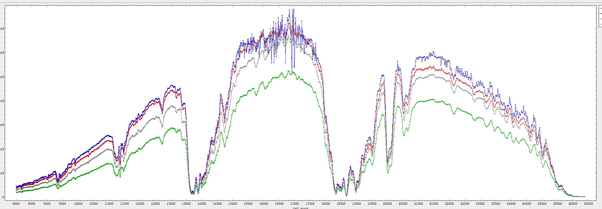
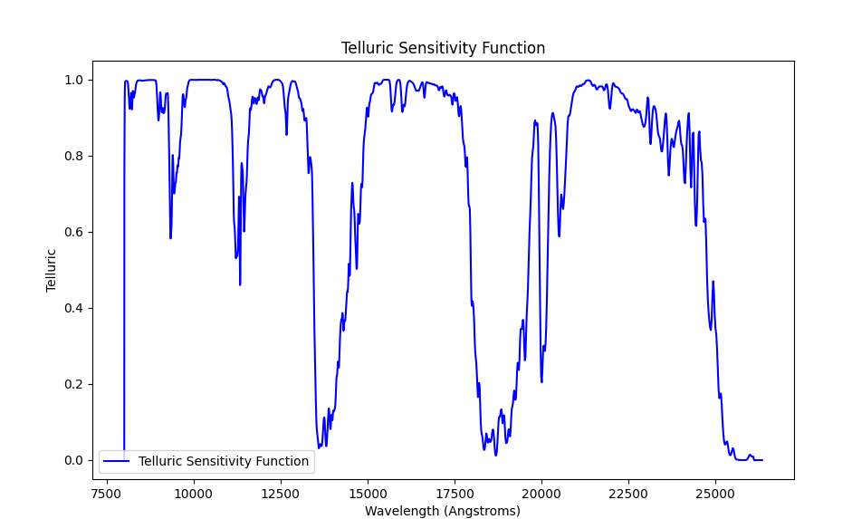
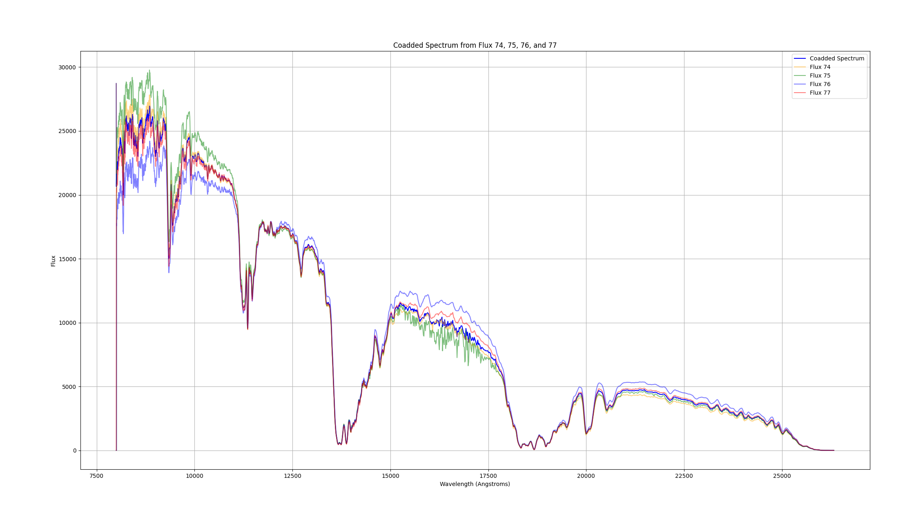
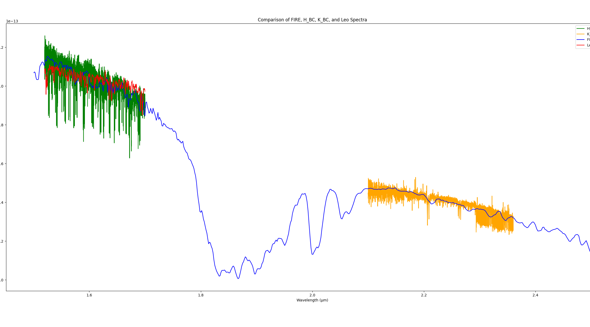

## 这是fire数据的处理流程

### 前置准备
  这是使用pypeit处理fire数据的流程，需要有python环境，目前使用Python 3.12.3版本是可以用的，python3.8以及更古老的版本可能会出问题。还需要pypeit，numpy, matploylib, astropy, pathlib等包

```bash
     source /home/yin/github_item/presto/presto_envronment.sh
     # 根据自己操作系统需要
```

  如果想复现本程序，初始情况下需要`./code/`, `./raw_data_2026may31/`和`./README.md`三个文件和文件夹，其他文件都可以后续生成。然后进入项目根目录。
  

### 主程序部分

  进入项目目录，在该目录下准备好`./raw_data_2026may31/`

  ```bash
        cd /mnt/disk1/myresource/fire
  ```
  在该文件夹下执行
  ```bash
        pypeit_setup -s magellan_fire_long -r raw_data_2026may31 -c all
  ```
  其中`magellan_fire_long`是在官网查的仪器名称，`raw_data_2026may31`是原始数据所在的文件夹。
  我们编辑文件`./magellan_fire_long_A/magellan_fire_long_A.pypeit`

  接下来我们先处理目标天体coconuts-2a的数据，为了实现A1-B1，B1-A1，A2-B2，B2-A2四个数据，我们编辑该文件，把它变成如下：

  ```bash
  # Auto-generated PypeIt input file using PypeIt version: 1.12.2
# UTC 2026-07-08T18:42:49.630

# User-defined execution parameters
[rdx]
    spectrograph = magellan_fire_long

# Setup
setup read
Setup A:
  decker: default
  dichroic: default
  dispname: Longslit
setup end

# Data block 
data read
 path ../raw_data_2026may31
      filename |       frametype |          ra |         dec |                         target | dispname |  decker | binning |                mjd | airmass | exptime | dichroic | calib | comb_id | bkg_id
fire_0074.fits |         science |  117.066289 | -76.7704208 |                    COCONUTS-2A | Longslit | default |     1,1 |  2461192.460104167 |   1.636 |     1.0 |  default |     0 |       1 |      2
fire_0075.fits |         science | 117.0561422 | -76.7716756 |                    COCONUTS-2A | Longslit | default |     1,1 |  2461192.462581019 |   1.642 |     1.0 |  default |     1 |       2 |      1
fire_0076.fits |         science | 117.0561422 | -76.7716756 |                    COCONUTS-2A | Longslit | default |     1,1 | 2461192.4634490744 |   1.642 |     1.0 |  default |     2 |       3 |      4
fire_0077.fits |         science | 117.0664243 | -76.7701989 |                    COCONUTS-2A | Longslit | default |     1,1 | 2461192.4659259263 |    1.65 |     1.0 |  default |     3 |       4 |      3
fire_0012.fits | pixelflat,trace | 114.7549155 | -29.0552251 | High_voltage_flats_2.1_gain3.8 | Longslit | default |     1,1 |  2461192.325381945 |     1.0 |    12.0 |  default |   all |      -1 |     -1
fire_0013.fits | pixelflat,trace | 114.7549155 | -29.0552251 | High_voltage_flats_2.1_gain3.8 | Longslit | default |     1,1 |  2461192.326284723 |     1.0 |    12.0 |  default |   all |      -1 |     -1
fire_0014.fits | pixelflat,trace | 114.7549155 | -29.0552251 | High_voltage_flats_2.1_gain3.8 | Longslit | default |     1,1 | 2461192.3271643524 |     1.0 |    12.0 |  default |   all |      -1 |     -1
fire_0015.fits | pixelflat,trace | 114.7549155 | -29.0552251 | High_voltage_flats_2.1_gain3.8 | Longslit | default |     1,1 |   2461192.32806713 |     1.0 |    12.0 |  default |   all |      -1 |     -1
fire_0016.fits | pixelflat,trace | 114.7549155 | -29.0552251 | High_voltage_flats_2.1_gain3.8 | Longslit | default |     1,1 |  2461192.328958334 |     1.0 |    12.0 |  default |   all |      -1 |     -1
fire_0017.fits | pixelflat,trace | 114.7549155 | -29.0552251 | High_voltage_flats_2.1_gain3.8 | Longslit | default |     1,1 | 2461192.3298495375 |     1.0 |    12.0 |  default |   all |      -1 |     -1
fire_0018.fits | pixelflat,trace | 114.7549155 | -29.0552251 | High_voltage_flats_2.1_gain3.8 | Longslit | default |     1,1 | 2461192.3307407415 |     1.0 |    12.0 |  default |   all |      -1 |     -1
fire_0019.fits | pixelflat,trace | 114.7549155 | -29.0552251 | High_voltage_flats_2.1_gain3.8 | Longslit | default |     1,1 |  2461192.331631945 |     1.0 |    12.0 |  default |   all |      -1 |     -1
fire_0020.fits | pixelflat,trace | 114.7549155 | -29.0552251 | High_voltage_flats_2.1_gain3.8 | Longslit | default |     1,1 | 2461192.3325231485 |     1.0 |    12.0 |  default |   all |      -1 |     -1
fire_0021.fits | pixelflat,trace | 114.7549155 | -29.0552251 | High_voltage_flats_2.1_gain3.8 | Longslit | default |     1,1 | 2461192.3334143525 |     1.0 |    12.0 |  default |   all |      -1 |     -1
fire_0054.fits | pixelflat,trace |  128.505907 | -29.0543941 | High_voltage_flats_1.5_gain3.8 | Longslit | default |     1,1 | 2461192.3635648154 |     1.0 |    20.0 |  default |   all |      -1 |     -1
fire_0055.fits | pixelflat,trace | 128.9734482 |  -29.054359 | High_voltage_flats_1.5_gain3.8 | Longslit | default |     1,1 |  2461192.364803241 |     1.0 |    20.0 |  default |   all |      -1 |     -1
fire_0056.fits | pixelflat,trace | 128.9734482 |  -29.054359 | High_voltage_flats_1.5_gain3.8 | Longslit | default |     1,1 | 2461192.3657754636 |     1.0 |    20.0 |  default |   all |      -1 |     -1
fire_0057.fits | pixelflat,trace | 128.9734482 |  -29.054359 | High_voltage_flats_1.5_gain3.8 | Longslit | default |     1,1 | 2461192.3667708337 |     1.0 |    20.0 |  default |   all |      -1 |     -1
fire_0058.fits | pixelflat,trace | 128.9734482 |  -29.054359 | High_voltage_flats_1.5_gain3.8 | Longslit | default |     1,1 | 2461192.3677546303 |     1.0 |    20.0 |  default |   all |      -1 |     -1
fire_0059.fits | pixelflat,trace | 128.9734482 |  -29.054359 | High_voltage_flats_1.5_gain3.8 | Longslit | default |     1,1 | 2461192.3687384264 |     1.0 |    20.0 |  default |   all |      -1 |     -1
fire_0060.fits | pixelflat,trace | 128.9734482 |  -29.054359 | High_voltage_flats_1.5_gain3.8 | Longslit | default |     1,1 | 2461192.3698495375 |     1.0 |    20.0 |  default |   all |      -1 |     -1
fire_0061.fits | pixelflat,trace | 128.9734482 |  -29.054359 | High_voltage_flats_1.5_gain3.8 | Longslit | default |     1,1 |  2461192.370833334 |     1.0 |    20.0 |  default |   all |      -1 |     -1
fire_0062.fits | pixelflat,trace | 128.9734482 |  -29.054359 | High_voltage_flats_1.5_gain3.8 | Longslit | default |     1,1 |   2461192.37181713 |     1.0 |    20.0 |  default |   all |      -1 |     -1
fire_0063.fits | pixelflat,trace | 128.9734482 |  -29.054359 | High_voltage_flats_1.5_gain3.8 | Longslit | default |     1,1 | 2461192.3728125007 |     1.0 |    20.0 |  default |   all |      -1 |     -1
fire_0078.fits |        arc,tilt | 117.0663011 | -76.7701431 |                         NeArNe | Longslit | default |     1,1 |  2461192.468032408 |   1.656 |     1.0 |  default |   all |      -1 |     -1
#fire_0079.fits |        standard |  113.168902 | -77.0671078 |                        HD62139 | Longslit | default |     1,1 | 2461192.4723495375 |   1.703 |     1.0 |  default |     0 |       1 |      2
#fire_0080.fits |        standard | 113.1569688 | -77.0681076 |                        HD62139 | Longslit | default |     1,1 |  2461192.473344908 |   1.707 |     1.0 |  default |     1 |       2 |      1
#fire_0081.fits |        standard | 113.1572225 | -77.0680527 |                        HD62139 | Longslit | default |     1,1 | 2461192.4744675932 |    1.71 |     1.0 |  default |     2 |       3 |      4
#fire_0082.fits |        standard | 113.1688654 | -77.0669966 |                        HD62139 | Longslit | default |     1,1 |  2461192.476331019 |   1.715 |     1.0 |  default |     3 |       4 |      3
#fire_0083.fits |        standard | 113.1688654 | -77.0669966 |                        HD62139 | Longslit | default |     1,1 |  2461192.477083334 |   1.715 |     1.0 |  default |     4 |       5 |      6
#fire_0084.fits |        standard | 113.1570983 | -77.0680246 |                        HD62139 | Longslit | default |     1,1 |   2461192.47832176 |   1.721 |     1.0 |  default |     5 |       6 |      5
#fire_0085.fits |        standard | 113.1570983 | -77.0680246 |                        HD62139 | Longslit | default |     1,1 | 2461192.4790740744 |   1.721 |     1.0 |  default |     6 |       7 |      8
#fire_0086.fits |        standard | 113.1686562 | -77.0669961 |                        HD62139 | Longslit | default |     1,1 | 2461192.4803125006 |   1.728 |     1.0 |  default |     7 |       8 |      7
#fire_0087.fits |        arc,tilt | 113.1686535 | -77.0670517 |                         NeArNe | Longslit | default |     1,1 |  2461192.481805556 |   1.732 |     1.0 |  default |   all |      -1 |     -1
data end
```


  >其中
  >①# Data block 的path要指向RAWDIR的绝对路径
  >
  >②对我们而言，fire78，fire87的framtype改为arc,tilt；fire74-77改为science
  >
  >③对于ABBA模式我们如图将目标星和标准星配置参数,其他条目calib 为all
  >
  >④确保每一行的竖线对齐即可 仪器改为spectrograph = magellan_fire_long

  然后
  ```bash
  cd magellan_fire_long_A
  run_pypeit magellan_fire_long_A.pypeit
  ```
  我们等待十几分钟后就可以去`/magellan_fire_long_A/Science/`文件夹下拿结果了

  我们可以把文件夹重命名
  ```bash
  mv Science Science.coconuts
  ```

  然后我们可以在查询`magellan_fire_long_A/Science.coconuts`里面的内容，这里面应该有4个1d的fits文件和4个txt文件，分别对应75-76，76-75，77-78，78-77.

  我们可以对比这四个wavelength和counts的图像：

  

  其中红，蓝，绿，灰分别为Science.coconuts文件夹下的75，76，77，78文件。

  接下来我们处理标准星的文件，先删除一些
  ```bash
  rm -r Calibrations/
  rm -r QA/
  ```

  然后编辑`magellan_fire_long_A.pypeit`文件：

  ```bash
  # Auto-generated PypeIt input file using PypeIt version: 1.12.2
# UTC 2026-07-08T18:42:49.630

# User-defined execution parameters
[rdx]
    spectrograph = magellan_fire_long

# Setup
setup read
Setup A:
  decker: default
  dichroic: default
  dispname: Longslit
setup end

# Data block 
data read
 path ../raw_data_2026may31
      filename |       frametype |          ra |         dec |                         target | dispname |  decker | binning |                mjd | airmass | exptime | dichroic | calib | comb_id | bkg_id
#fire_0074.fits |         science |  117.066289 | -76.7704208 |                    COCONUTS-2A | Longslit | default |     1,1 |  2461192.460104167 |   1.636 |     1.0 |  default |     0 |       1 |      2
#fire_0075.fits |         science | 117.0561422 | -76.7716756 |                    COCONUTS-2A | Longslit | default |     1,1 |  2461192.462581019 |   1.642 |     1.0 |  default |     1 |       2 |      1
#fire_0076.fits |         science | 117.0561422 | -76.7716756 |                    COCONUTS-2A | Longslit | default |     1,1 | 2461192.4634490744 |   1.642 |     1.0 |  default |     2 |       3 |      4
#fire_0077.fits |         science | 117.0664243 | -76.7701989 |                    COCONUTS-2A | Longslit | default |     1,1 | 2461192.4659259263 |    1.65 |     1.0 |  default |     3 |       4 |      3
fire_0012.fits | pixelflat,trace | 114.7549155 | -29.0552251 | High_voltage_flats_2.1_gain3.8 | Longslit | default |     1,1 |  2461192.325381945 |     1.0 |    12.0 |  default |   all |      -1 |     -1
fire_0013.fits | pixelflat,trace | 114.7549155 | -29.0552251 | High_voltage_flats_2.1_gain3.8 | Longslit | default |     1,1 |  2461192.326284723 |     1.0 |    12.0 |  default |   all |      -1 |     -1
fire_0014.fits | pixelflat,trace | 114.7549155 | -29.0552251 | High_voltage_flats_2.1_gain3.8 | Longslit | default |     1,1 | 2461192.3271643524 |     1.0 |    12.0 |  default |   all |      -1 |     -1
fire_0015.fits | pixelflat,trace | 114.7549155 | -29.0552251 | High_voltage_flats_2.1_gain3.8 | Longslit | default |     1,1 |   2461192.32806713 |     1.0 |    12.0 |  default |   all |      -1 |     -1
fire_0016.fits | pixelflat,trace | 114.7549155 | -29.0552251 | High_voltage_flats_2.1_gain3.8 | Longslit | default |     1,1 |  2461192.328958334 |     1.0 |    12.0 |  default |   all |      -1 |     -1
fire_0017.fits | pixelflat,trace | 114.7549155 | -29.0552251 | High_voltage_flats_2.1_gain3.8 | Longslit | default |     1,1 | 2461192.3298495375 |     1.0 |    12.0 |  default |   all |      -1 |     -1
fire_0018.fits | pixelflat,trace | 114.7549155 | -29.0552251 | High_voltage_flats_2.1_gain3.8 | Longslit | default |     1,1 | 2461192.3307407415 |     1.0 |    12.0 |  default |   all |      -1 |     -1
fire_0019.fits | pixelflat,trace | 114.7549155 | -29.0552251 | High_voltage_flats_2.1_gain3.8 | Longslit | default |     1,1 |  2461192.331631945 |     1.0 |    12.0 |  default |   all |      -1 |     -1
fire_0020.fits | pixelflat,trace | 114.7549155 | -29.0552251 | High_voltage_flats_2.1_gain3.8 | Longslit | default |     1,1 | 2461192.3325231485 |     1.0 |    12.0 |  default |   all |      -1 |     -1
fire_0021.fits | pixelflat,trace | 114.7549155 | -29.0552251 | High_voltage_flats_2.1_gain3.8 | Longslit | default |     1,1 | 2461192.3334143525 |     1.0 |    12.0 |  default |   all |      -1 |     -1
fire_0054.fits | pixelflat,trace |  128.505907 | -29.0543941 | High_voltage_flats_1.5_gain3.8 | Longslit | default |     1,1 | 2461192.3635648154 |     1.0 |    20.0 |  default |   all |      -1 |     -1
fire_0055.fits | pixelflat,trace | 128.9734482 |  -29.054359 | High_voltage_flats_1.5_gain3.8 | Longslit | default |     1,1 |  2461192.364803241 |     1.0 |    20.0 |  default |   all |      -1 |     -1
fire_0056.fits | pixelflat,trace | 128.9734482 |  -29.054359 | High_voltage_flats_1.5_gain3.8 | Longslit | default |     1,1 | 2461192.3657754636 |     1.0 |    20.0 |  default |   all |      -1 |     -1
fire_0057.fits | pixelflat,trace | 128.9734482 |  -29.054359 | High_voltage_flats_1.5_gain3.8 | Longslit | default |     1,1 | 2461192.3667708337 |     1.0 |    20.0 |  default |   all |      -1 |     -1
fire_0058.fits | pixelflat,trace | 128.9734482 |  -29.054359 | High_voltage_flats_1.5_gain3.8 | Longslit | default |     1,1 | 2461192.3677546303 |     1.0 |    20.0 |  default |   all |      -1 |     -1
fire_0059.fits | pixelflat,trace | 128.9734482 |  -29.054359 | High_voltage_flats_1.5_gain3.8 | Longslit | default |     1,1 | 2461192.3687384264 |     1.0 |    20.0 |  default |   all |      -1 |     -1
fire_0060.fits | pixelflat,trace | 128.9734482 |  -29.054359 | High_voltage_flats_1.5_gain3.8 | Longslit | default |     1,1 | 2461192.3698495375 |     1.0 |    20.0 |  default |   all |      -1 |     -1
fire_0061.fits | pixelflat,trace | 128.9734482 |  -29.054359 | High_voltage_flats_1.5_gain3.8 | Longslit | default |     1,1 |  2461192.370833334 |     1.0 |    20.0 |  default |   all |      -1 |     -1
fire_0062.fits | pixelflat,trace | 128.9734482 |  -29.054359 | High_voltage_flats_1.5_gain3.8 | Longslit | default |     1,1 |   2461192.37181713 |     1.0 |    20.0 |  default |   all |      -1 |     -1
fire_0063.fits | pixelflat,trace | 128.9734482 |  -29.054359 | High_voltage_flats_1.5_gain3.8 | Longslit | default |     1,1 | 2461192.3728125007 |     1.0 |    20.0 |  default |   all |      -1 |     -1
#fire_0078.fits |        arc,tilt | 117.0663011 | -76.7701431 |                         NeArNe | Longslit | default |     1,1 |  2461192.468032408 |   1.656 |     1.0 |  default |   all |      -1 |     -1
fire_0079.fits |        standard |  113.168902 | -77.0671078 |                        HD62139 | Longslit | default |     1,1 | 2461192.4723495375 |   1.703 |     1.0 |  default |     0 |       1 |      2
fire_0080.fits |        standard | 113.1569688 | -77.0681076 |                        HD62139 | Longslit | default |     1,1 |  2461192.473344908 |   1.707 |     1.0 |  default |     1 |       2 |      1
fire_0081.fits |        standard | 113.1572225 | -77.0680527 |                        HD62139 | Longslit | default |     1,1 | 2461192.4744675932 |    1.71 |     1.0 |  default |     2 |       3 |      4
fire_0082.fits |        standard | 113.1688654 | -77.0669966 |                        HD62139 | Longslit | default |     1,1 |  2461192.476331019 |   1.715 |     1.0 |  default |     3 |       4 |      3
fire_0083.fits |        standard | 113.1688654 | -77.0669966 |                        HD62139 | Longslit | default |     1,1 |  2461192.477083334 |   1.715 |     1.0 |  default |     4 |       5 |      6
fire_0084.fits |        standard | 113.1570983 | -77.0680246 |                        HD62139 | Longslit | default |     1,1 |   2461192.47832176 |   1.721 |     1.0 |  default |     5 |       6 |      5
fire_0085.fits |        standard | 113.1570983 | -77.0680246 |                        HD62139 | Longslit | default |     1,1 | 2461192.4790740744 |   1.721 |     1.0 |  default |     6 |       7 |      8
fire_0086.fits |        standard | 113.1686562 | -77.0669961 |                        HD62139 | Longslit | default |     1,1 | 2461192.4803125006 |   1.728 |     1.0 |  default |     7 |       8 |      7
fire_0087.fits |        arc,tilt | 113.1686535 | -77.0670517 |                         NeArNe | Longslit | default |     1,1 |  2461192.481805556 |   1.732 |     1.0 |  default |   all |      -1 |     -1
data end
  ```

  然后
  ```
  run_pypeit magellan_fire_long_A.pypeit
  ```
  我们等待十几分钟后就可以去`/magellan_fire_long_A/Science/`文件夹下拿标准星结果了:

  ```bash
  mv Science Science.standard
  ```

  我们发现不知为何81号文件出现了多了一张数据表的问题。

###  sensfunc 部分
  接下来我们进入`magellan_fire_long_A/Science.standard/`文件夹。创建`sensfunc_Jband.inp`文件,然后编辑
  ```bash
  cd Science.standard/
  touch sensfunc_Jband.inp
  ```

  在`sensfunc_Jband.inp`文件里面添加,该写法参考了https://pypeit.readthedocs.io/en/stable/tutorials/nirspec_high_howto.html
  
  ```json
  [sensfunc]
    algorithm = IR
    star_mag = 10.03
    star_type = PHOENIX
  #   flatfile = /mnt/disk1/myresource/fire_reduction/magellan_fire_A/Calibrations/Flat_A_all_DET01.fits
    [[IR]]
        telgridfile = 'TellPCA_3000_26000_R10000.fits'
  ```

  然后执行
  ```bash
  pypeit_sensfunc spec1d_fire_0079-HD62139_FIRE_85970523T112011.000.fits  -s sensfunc_Jband.inp -o ./sensfunc.fits
  ```
  等待5分钟，我们就得到了`magellan_fire_long_A/Science.standard/sensfunc.fits`文件，这是只针对79的sensfunc。

  接下来我们先检查一下这份文件。我们回到项目根目录，执行命令
  ```bash
  python code/show_sensfunc.py
  ```

  我们应该能得到图像

  

### fluxing 部分
  接下来我们进行对目标星的fluxing。
  先做准备工作：
  ```bash
  cd magellan_fire_long_A
  mkdir 74
  cp Science.coconuts/spec1d_fire_0074* 74/
  cp Science.standard/sensfunc.fits 74/

  mkdir 75
  cp Science.coconuts/spec1d_fire_0075* 75/
  cp Science.standard/sensfunc.fits 75/

  mkdir 76
  cp Science.coconuts/spec1d_fire_0076* 76/
  cp Science.standard/sensfunc.fits 76/

  mkdir 77
  cp Science.coconuts/spec1d_fire_0077* 77/
  cp Science.standard/sensfunc.fits 77/
  ```

然后我们以74为例进行fluxing，其它几个一样操作即可

```bash
cd 74
pypeit_flux_setup .
```

然后该文件夹下就会出现一些配置文件，现在该文件夹内容如下：

```bash
ls
magellan_fire_long.coadd1d
magellan_fire_long.flux
magellan_fire_long.tell
sensfunc.fits
spec1d_fire_0074-COCONUTS-2A_FIRE_85970523T110233.000.fits
spec1d_fire_0074-COCONUTS-2A_FIRE_85970523T110233.000.txt
```
之后修改`magellan_fire_long.flux`,

```bash
sed -E 's#^(spec1d_[^|]+\.fits).*$#\1| sensfunc.fits#' magellan_fire_long.flux > tmp.flux && mv tmp.flux magellan_fire_long.flux
```

使得`magellan_fire_long.flux`变成如下内容：

```
# Auto-generated Flux input file using PypeIt version: 2.0.1
# UTC 2026-10-13T01:02:29.396+00:00

# User-defined execution parameters
[fluxcalib]
  extinct_correct = False  # Set to True if your SENSFUNC derived with the UVIS algorithm
# Please add your SENSFUNC file name below before running pypeit_flux_calib

# Data block 
flux read
 path .
                                                  filename | sensfile
spec1d_fire_0074-COCONUTS-2A_FIRE_85970523T110233.000.fits| sensfunc.fits
flux end
```

然后执行```pypeit_flux_calib magellan_fire_long.flux```  
注意，这一步会直接写入源文件

接下来处理其它几75，76，77：

```bash
cd ..
cd 75
pypeit_flux_setup .
sed -E 's#^(spec1d_[^|]+\.fits).*$#\1| sensfunc.fits#' magellan_fire_long.flux > tmp.flux && mv tmp.flux magellan_fire_long.flux
pypeit_flux_calib magellan_fire_long.flux

cd ..
cd 76
pypeit_flux_setup .
sed -E 's#^(spec1d_[^|]+\.fits).*$#\1| sensfunc.fits#' magellan_fire_long.flux > tmp.flux && mv tmp.flux magellan_fire_long.flux
pypeit_flux_calib magellan_fire_long.flux

cd ..
cd 77
pypeit_flux_setup .
sed -E 's#^(spec1d_[^|]+\.fits).*$#\1| sensfunc.fits#' magellan_fire_long.flux > tmp.flux && mv tmp.flux magellan_fire_long.flux
pypeit_flux_calib magellan_fire_long.flux

cd ../..

```
之后我们可以运行

```bash
python code/show_fluxing.py
# 如果需要coadd
python code/coadd.py
```

$F_j=\frac{\sum{F_{ij}{IVAR}{ij}}}{\sum{{IVAR}{ij}}}$和 $\delta=\frac{1}{\sqrt{\sum{IVAR_{ij}}}}$



我们可以在`code/coadded_spectrum.txt`拿到coadd结果,波长单位修正成了微米




增加，H和K都应该有模板星对比。

新增加echelle mode https://www.dropbox.com/scl/fo/3xoiw3crp4ulhxgl6yyop/AAeKg4-x7vqT5oZa7sTcqMA?rlkey=h6dtsrr98g4t2i3e82mbigg1m&dl=0  里面有三套flat，都要使用。

下次开会：下周四10.22晚上九点半


